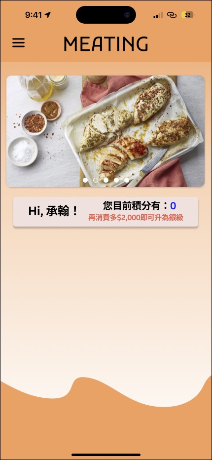
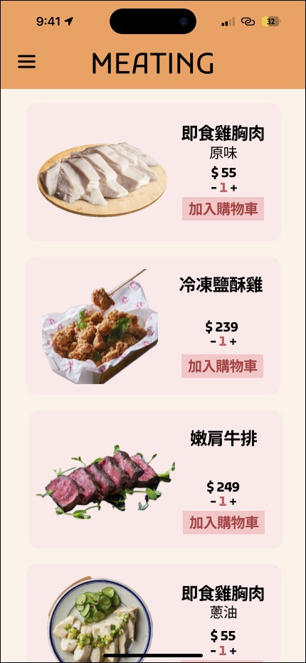
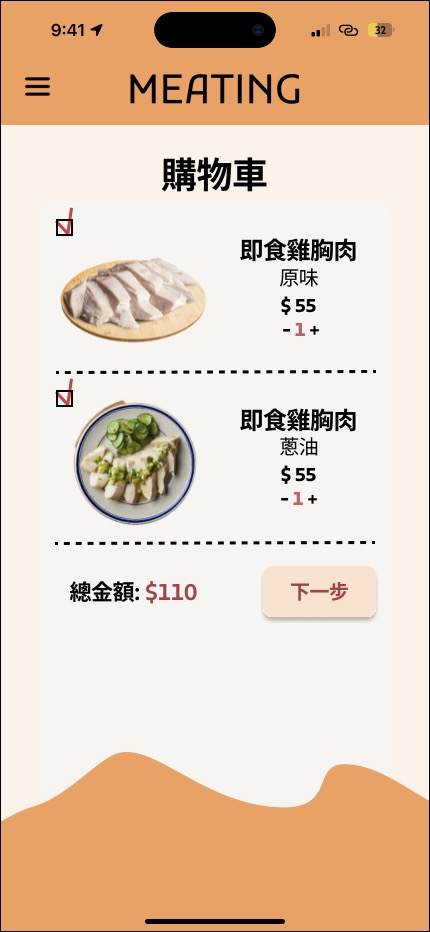
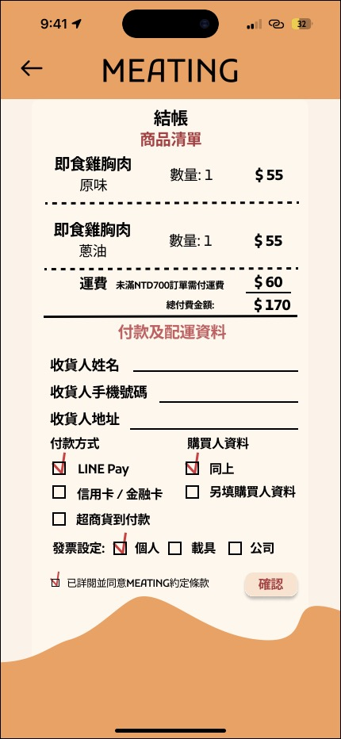
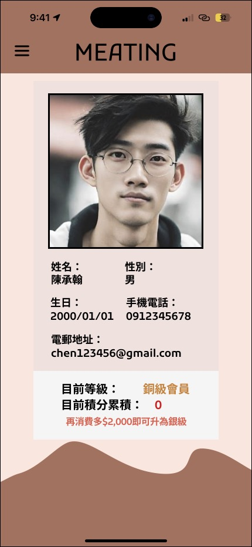
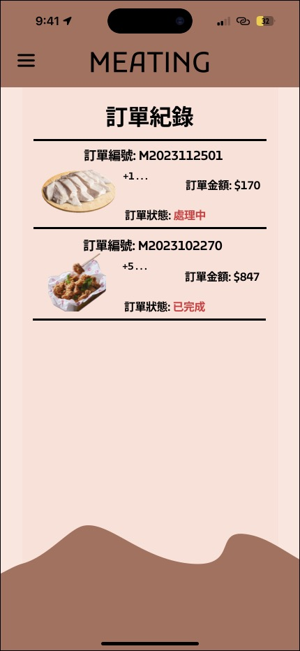
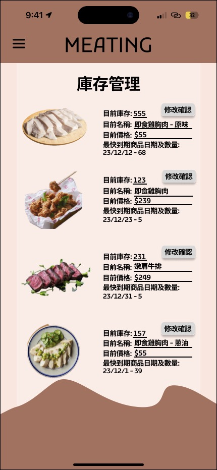
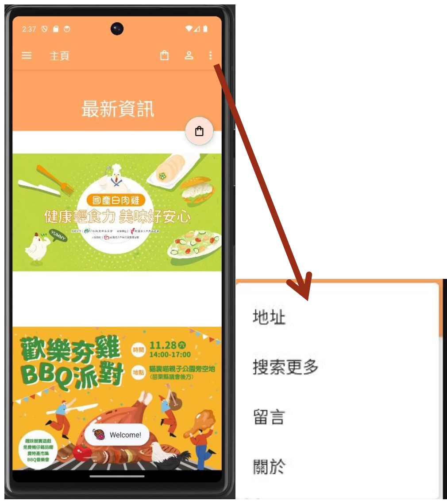
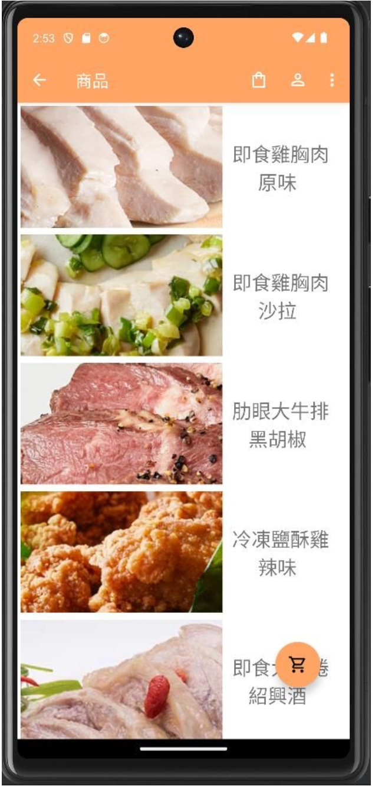
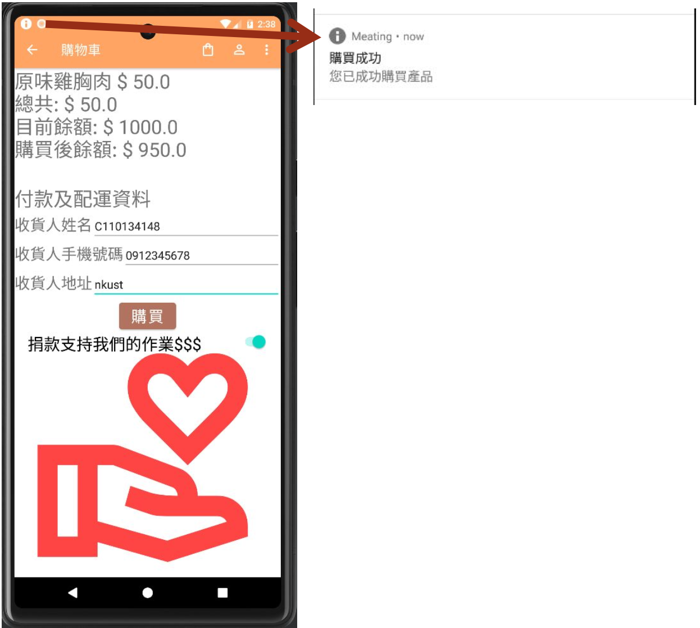

# Meating – Android Shopping Application

An Android shopping application for a fictional ready-to-eat meat brand, developed collaboratively as an academic group project, building upon an original UI/UX design created in Figma.

## Project Overview

Meating is an Android shopping application developed as a group project for an Android Programming course at National Kaohsiung University of Science and Technology (NKUST).

The project builds upon an earlier Systems Analysis and Design project, in which I served as team leader and independently designed the original iOS-based UI/UX using Figma. The team subsequently reused these designs as the foundation for the Android application.

As team leader of both projects, I contributed to team coordination and project documentation. During Android development, I also participated in collaborative coding of the application's logic and functionality, communicated the original design concepts to the team member responsible for Android UI implementation, and assisted in reviewing the interface for design consistency and implementation feasibility.

## My Contributions

### Project Leadership

- Served as team leader for both the Systems Analysis and Design and Android Programming projects.
- Contributed to team coordination, task organisation, and project documentation.

### UI/UX Design – Individual Responsibility

I independently designed the original UI/UX of Meating using Figma as part of the Systems Analysis and Design project.

- Designed the original iOS interface, including the visual identity, colour palette, typography, branding, and interface style.
- Created the application's navigation structure and user flows, connecting key screens through interactive prototype elements.
- Developed an interactive Figma prototype in which most buttons and interface elements were clickable, allowing users to navigate between screens and experience the proposed application workflows.
- Designed layouts for customer-facing screens, including the home page, product catalogue, login and registration, shopping cart, checkout, member profile, and order history.
- Designed administrative interfaces, including inventory management screens.
- Established a consistent visual experience across different application sections.
- Provided the original Figma designs as the UI/UX reference for the subsequent Android Programming project.

### Android Application Development – Group Collaboration

The Android application was developed collaboratively by the project team, using the original Figma designs as the UI/UX reference.

- Participated in collaborative Android development, including coding application logic and functionality.
- Communicated and handed over the original Figma design concepts and interface specifications to the team member responsible for Android UI implementation.
- Assisted in reviewing the implemented Android interfaces to ensure consistency with the original designs, while considering implementation feasibility and the team's coding capabilities.
- Contributed to preparing the written project report documenting the system analysis, design, and development process.process.

## UI/UX Design – Figma

The original Meating UI/UX design was developed as part of an earlier Systems Analysis and Design project, where I independently designed the application interface using Figma with iOS devices as the initial design platform. I also developed an interactive Figma prototype, with most buttons and interface elements linked to corresponding screens to demonstrate the proposed navigation and user interaction flows.

For the subsequent Android Programming project, the team reused the original design concepts and layouts as the foundation for the Android application. Rather than creating a separate design from scratch, the existing interface was used as a reference during Android implementation.

I communicated the original Figma design concepts and interface specifications to the team member responsible for Android UI implementation, while assisting with design reviews and implementation considerations.

📱 **[View Complete Interactive Figma Design](https://www.figma.com/design/wJNc1m53s84f4AR43IcyaF/MEATING-Application-Project?t=SbxSSODQokVkWC14-1)**

### Selected Figma Design Screens

The following screenshots showcase my original UI/UX design work created in Figma.

#### Home Screen & Product Catalogue

<table>
<tr>
<td align="center">
<strong>Home Screen</strong> 

</td>
<td align="center">
<strong>Product Catalogue</strong> 

</td>
</tr>
</table>

#### Shopping Cart & Checkout

<table>
<tr>
<td align="center">
<strong>Shopping Cart</strong> 

</td>
<td align="center">
<strong>Checkout</strong> 

</td>
</tr>
</table>

#### Membership & Order History

<table>
<tr>
<td align="center">
<strong>Membership</strong> 

</td>
<td align="center">
<strong>Order History<strong> 

</td>
</tr>
</table>

#### Administrative Interface

## Selected Implemented Android App Screens

The Android application was implemented collaboratively by the project team based on the original Figma designs. The following screenshots demonstrate selected interfaces from the implemented application.

#### Home Screen & Product Catalogue

<table>
 <tr>
   <td align="center">
     <strong>Home Screen</strong> 
     
   </td>
   <td align="center">
     <strong>Product Catalogue<strong> 
     
   </td>
 </tr>
</table>

#### Shopping Cart & Membership

<table>
 <tr>
   <td align="center">
     <strong>Shopping Cart<strong> 
     
   </td>
   <td align="center">
     <strong>Membership<strong> 
     
   </td>
 </tr>
</table>

## Key Features

### 1. Product Browsing and Shopping

- Browse ready-to-eat meat products.
- View product images, descriptions, and prices.
- Select products and quantities for purchase.

### 2. Shopping Cart and Checkout

- Add products to the shopping cart.
- Adjust product quantities and review selected items.
- Calculate order totals, including delivery fees.
- Enter recipient and delivery information.
- Select from the payment options presented in the checkout interface.
- Display order submission confirmation.

### 3. Membership Management

- Register and log in to a member account.
- View personal profile information.
- Access membership-related functions.
- Review previous purchase records.

### 4. Order History

- Display previous orders and their order numbers.
- Review order amounts and order statuses.

### 5. Inventory Management

- Provide an administrative inventory interface.
- Display product stock quantities, names, and prices.
- Present expiry-date and stock information for inventory management.

## Technologies Used

### Design

- **UI/UX Design:** Figma

### Application Development

- **Programming Language:** Java
- **Platform:** Android
- **UI Development:** Android XML Layouts
- **Build System:** Gradle (Kotlin DSL)
- **Local Database:** SQLite
- **Local Data Storage:** SharedPreferences
- **Android Components:** Activities, Fragments, DialogFragment
- **Android Features:** Intents, BroadcastReceiver, Toast, Navigation Drawer

## Application Architecture

The application follows a standard Android project structure, with an Activity as the main entry point and separate components for membership, product selection, and database operations.

### Main Components

| Component                    | Responsibility                                                                                               |
| ---------------------------- | ------------------------------------------------------------------------------------------------------------ |
| `MainActivity.java`          | Main application activity, navigation, product loading, shopping flow, and application-level event handling. |
| `RegisterActivity.java`      | Handles member registration.                                                                                 |
| `DBHelper.java`              | Manages the local SQLite database and table creation.                                                        |
| `ProductDialogFragment.java` | Displays product selection options and size-dependent pricing.                                               |
| `LoginDialogFragment.java`   | Provides the member login dialog.                                                                            |
| `LoginOutListener.java`      | Supports login and logout event handling.                                                                    |
| `ui/`                        | Contains UI-related packages and application fragments.                                                      |

### Data Storage

The application uses local data storage for different purposes:

- **SharedPreferences:** Stores local account credentials and user preferences.
- **SQLite Database:** Stores purchase records and related order information.
- **XML Resources:** Provides product information used by the application.

## How to Run

### Prerequisites

- Android Studio
- Android SDK compatible with the project configuration
- JDK compatible with the Gradle configuration
- Android Emulator or a physical Android device

### Setup Instructions

**1. Download or clone the repository**

Download the project files or clone this repository to your local machine.

**2. Open the project in Android Studio**

- Launch Android Studio.
- Select **Open**.
- Navigate to the downloaded project root folder.
- Open the folder containing `settings.gradle.kts` and `build.gradle.kts`.

**3. Synchronise Gradle**

Allow Android Studio to synchronise the Gradle project and download the required dependencies.

**4. Configure an Android device**

- Start an Android Emulator or connect a physical Android device.
- Enable USB debugging if using a physical device.

**5. Run the application**

- Select the `app` run configuration in Android Studio.
- Choose the target emulator or connected device.
- Click **Run** to install and launch the application.

## What I Learned

Through this project, I gained experience in:

- Applying system analysis and design concepts to mobile application planning and development.
- Independently translating system requirements into UI/UX designs using Figma.
- Independently designing a complete mobile application UI/UX in Figma.
- Developing a consistent visual identity and navigation structure across multiple application screens.
- Translating user requirements into interface layouts and user journeys.
- Communicating design specifications and collaborating with developers during UI implementation.
- Participating in collaborative Android application development using Java.
- Understanding Android application architecture and local data management.
- Working with mobile shopping workflows, including product selection, cart management, checkout, and membership services.
- Preparing technical documentation and collaborating throughout the software development process.

## Additional Documentation

The following project reports provide further details about the system analysis, original UI/UX design, and Android application development. Both reports are available in Traditional Chinese (繁體中文).

- 📄 [Systems Analysis and Design Report](docs/Systems-Analysis-and-Design-Report.pdf)
- 📄 [Android Programming Report](docs/Meating-Android-Project-Report-zh-TW.pdf)

## Project Information

- **Project Name:** Meating
- **Project Type:** Academic Group Project
- **Courses:** Systems Analysis and Design; Android Programming
- **Institution:** National Kaohsiung University of Science and Technology (NKUST)
- **Project Role:** Team Leader (Both Projects)
- **Individual Contribution:** Original UI/UX Design, Android Application Development, and Project Documentation
- **Design Tool:** Figma
- **Application Platform:** Android
- **Programming Language:** Java
- **Completion Date:** January 2024

---

*This project was developed for academic purposes as a collaborative exercise in mobile application design and development.*
